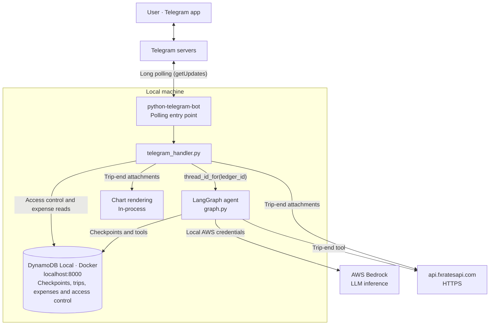
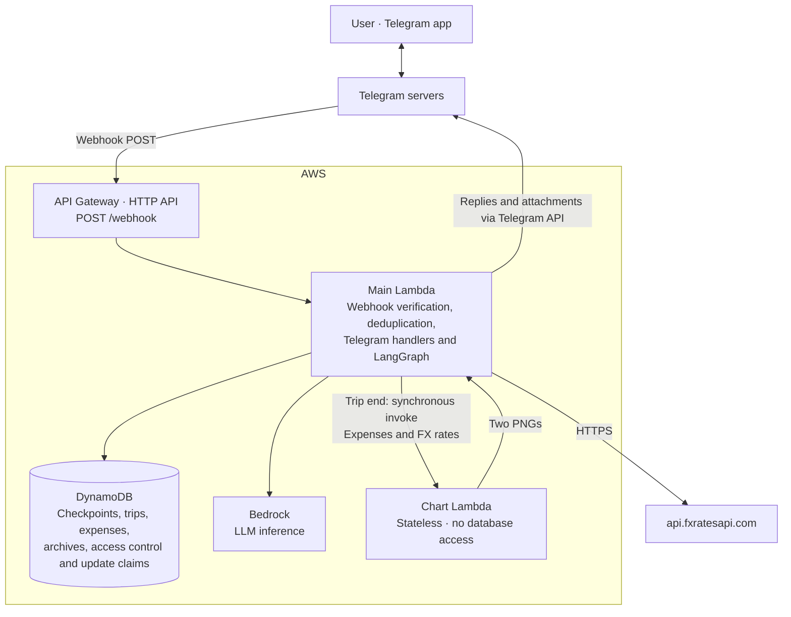
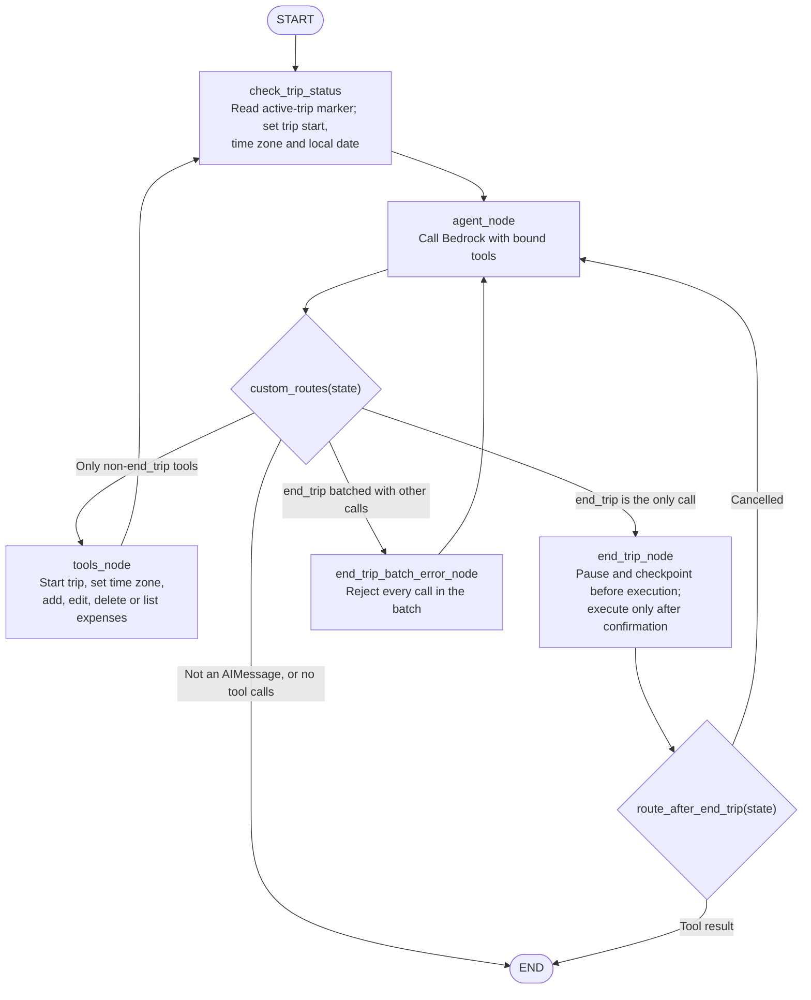
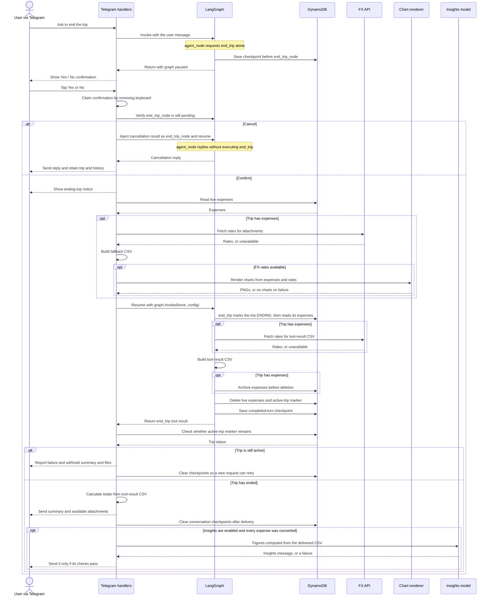

# Architecture: Overseas Expenses Telegram Bot

## Overview

An agentic Telegram chatbot — *Zuzu* — that helps users track overseas travel expenses. The agent uses LangGraph for stateful conversation management, MiniMax M2.5 on AWS Bedrock as the LLM, and DynamoDB as the sole database (conversation history + expenses).

---

## Tech Stack

| Concern | Choice | Reason |
|---|---|---|
| LLM | MiniMax M2.5 (`minimax.minimax-m2.5`) on Bedrock | Evaluated for the bot's tool use and conversations |
| Trip insights | Claude Sonnet 4.6 (`global.anthropic.claude-sonnet-4-6`) on Bedrock | Writes the short insights message after a trip ends, from figures computed in code ([0015](docs/decisions/0015-trip-insights-from-a-separate-model.md)). Sonnet 4.5 is `LEGACY` in Bedrock; Sonnet 5.5 is not available to this account |
| Agent framework | LangGraph | Stateful agent execution with built-in checkpointing |
| LLM integration | `langchain-aws` (`ChatBedrockConverse`) | First-class LangChain/LangGraph integration with Bedrock |
| Telegram | `python-telegram-bot` | Well-maintained, supports both polling (local) and webhook (Lambda) |
| Database | DynamoDB (single-table) | Native CRUD with serverless storage |
| Local DB | DynamoDB Local (Docker) | Identical boto3 API; switch via `DYNAMODB_ENDPOINT_URL` env var |
| Conversation state | LangGraph DynamoDB checkpointer (`langgraph-checkpoint-aws`, `DynamoDBSaver`) | Persists graph state per chat; deleting checkpoints clears conversation history |
| Packaging | `uv` + `pyproject.toml` | Modern Python standard; fast installs; clean Lambda packaging |
| Charts | `matplotlib`, in a dedicated Lambda | Generate pie chart (by category) and bar chart (by day) as PNGs in memory; sent as Telegram photos on trip end. Isolated in its own function so the main one never imports matplotlib or numpy |
| CSV export | Python stdlib `csv` | Generate expense CSV with SGD-equivalent column on trip end; sent as Telegram file attachment. Kept free of matplotlib so `end_trip` can build it in the main function |
| FX rates | `api.fxratesapi.com` | Free, no auth required, simple GET |

---

## Repository Layout

```
ExpensesCalculatorAgenticBot/
├── ARCHITECTURE.md
├── RUNBOOK.md
├── pyproject.toml
├── docker-compose.yml            # DynamoDB Local and table creation
├── dev_runner.py                 # terminal conversations using the real graph
├── docs/decisions/               # accepted architecture decisions
├── scripts/
│   ├── build_lambda.py
│   ├── deploy_lambda.py
│   ├── compare_models.py         # first-response model comparison
│   ├── model_scenarios.py
│   ├── evaluate_model.py         # complete conversations using shared operations
│   ├── evaluation_scenarios.json
│   ├── preview_trip_analysis.py  # fact sheet and insights for sample trips; tunes the prompt
│   └── trip_fixtures/            # sample trip CSVs for the preview
├── src/bot/
│   ├── main.py                   # local polling and Lambda webhook entry point
│   ├── agent/                    # graph, nodes, state and system prompt
│   ├── tools/                    # trip, expense and FX operations
│   ├── storage/dynamodb.py
│   ├── telegram_handler.py       # messages, confirmation and access control
│   ├── conversation.py           # shared message, confirmation and cancellation operations
│   ├── auth.py
│   ├── dedup.py                  # duplicate webhook delivery detection
│   ├── timezones.py
│   ├── export.py                 # CSV export and SGD conversion
│   ├── trip_facts.py             # figures about a finished trip, computed from the CSV
│   ├── trip_analysis.py          # insights call, checks on its reply, best-effort wrapper
│   ├── trip_analysis_prompt.py   # the insights prompt, editable apart from the logic
│   ├── charts.py
│   ├── chart_handler.py          # separate chart Lambda entry point
│   ├── charts_client.py
│   ├── chart_protocol.py
│   ├── logging_setup.py
│   ├── turn_log.py
│   └── config.py
├── terraform/                    # application infrastructure and bootstrap config
└── tests/
    ├── conftest.py
    └── unit/                     # tools, storage, graph, handlers and scripts
```

A dedicated DynamoDB Local integration suite and additional model scenarios are roadmap items.

## Architecture Diagrams

### Local Development



### AWS Production (Phase 2)



The chart function exists so matplotlib and numpy stay out of the main function, which
would otherwise import them on every cold start — including one that only records an
expense. It is invoked once per trip end and never on an ordinary message.

Locally the charts are rendered in-process instead of invoked, since matplotlib is
installed in the dev environment. That branch is on `ENVIRONMENT`, the same switch that
decides whether secrets come from SSM. Beyond those two branches the code is identical
between local and prod — no business logic changes.

---

## Authentication

Two independent layers, both required in production.

### Layer A — Webhook origin verification (API Gateway, prod only)

An API Gateway HTTP API forwards `POST /webhook` to Lambda. Telegram sends the
`X-Telegram-Bot-Api-Secret-Token` header configured during webhook registration.
The handler compares it with the expected secret using `hmac.compare_digest` before
parsing or processing the update. Missing or incorrect secrets return 403; an
unconfigured secret rejects all deliveries.

The secret is stored in SSM Parameter Store as a SecureString and loaded at startup.
The deployed HTTP API uses this header check; the earlier REST API/IP-allowlist design
was superseded by [0002](docs/decisions/0002-http-api-authenticated-by-secret-token.md).

### Layer B — Access control (telegram_handler.py, local and prod)

`telegram_handler.py` checks the incoming `user_id` (or `chat_id` for groups) against `AUTH#<id>` items in DynamoDB before invoking the agent. This runs first, before any Bedrock or expense-related DynamoDB calls.

**DynamoDB schema for auth items:**

| PK | SK | Attributes |
|---|---|---|
| `AUTH#<id>` | `PROFILE` | `status` (PENDING/APPROVED/REJECTED), `entity_type` (USER/GROUP), `username`, `requested_at`, `reviewed_at` |

Telegram user IDs are positive integers; group IDs are negative — the same `AUTH#<id>` key scheme covers both. The `entity_type` field makes the distinction explicit for querying and display.

**Auth check logic (on every incoming message):**

1. Determine scope: private chat → use `user_id`; group chat → use `chat_id` (negative).
2. Look up `AUTH#<id>` for that scope only. Private and group approvals are independent — a user approved in a group is not approved for DMs, and vice versa.
3. `APPROVED` → proceed normally.
4. `PENDING` → reply "Your access request is still pending approval." Do nothing else.
5. `REJECTED` → silently ignore.
6. Not found → create `AUTH#<id>` with `status=PENDING`, then send an approval request to the admin.

**Approval request sent to the configured admin:**

```python
keyboard = InlineKeyboardMarkup([
    [InlineKeyboardButton("Approve", callback_data=f"auth:approve:{auth_id}")],
    [InlineKeyboardButton("Reject",  callback_data=f"auth:reject:{auth_id}")],
])
message = f"Access request from {display_name} ({entity_type} ID: {auth_id})"
```

Callback prefix `auth:` is handled by a dedicated `CallbackQueryHandler` in `main.py`, parallel to the existing `end_trip:` handler. On Approve/Reject, the handler updates `AUTH#<id>.status` and `reviewed_at` in DynamoDB and notifies the requester.

**Group extension:** Group and user approvals are independent scopes — being approved in a group does not grant direct message access, and vice versa.

- Private chat → check `AUTH#<user_id>` only.
- Group chat → check `AUTH#<chat_id>` (negative group ID) only.

Approving a group ID grants access to all members messaging the bot within that group. It does not affect whether those members can message the bot directly.

**Admin ID** is stored in config as `ADMIN_TELEGRAM_ID` (env var / SSM in prod), not hardcoded.

---

## LangGraph Agent Design

### Graph Structure



The diamonds represent conditional routing, not additional graph nodes.

The batch case exists because routing a mixed batch either way loses a call silently:
`tools_node` has no `end_trip` bound, and `end_trip_node` has none of the others. Worse,
`tools_node` is not interrupted, so a batched `end_trip` would skip the confirmation
entirely. Rejecting the whole batch is the only option that neither drops a tool call nor
deletes a trip without asking.

This is a ReAct loop implemented as a LangGraph graph. `agent_node` calls the configured Bedrock model with the bound tools. `custom_routes` then inspects the last message: anything that is not an `AIMessage` carrying tool calls ends the turn, an `end_trip` call on its own routes to `end_trip_node`, `end_trip` mixed with other tools routes to `end_trip_batch_error_node`, and any other tool call routes to `tools_node`. `tools_node` edges back through `check_trip_status`, so a trip started or moved to another time zone earlier in the turn — "start trip in Seoul, coffee 5" — is re-read, with its local date, before the model records the coffee. After `end_trip` runs, the graph ends with its tool result; a cancellation returns to `agent_node` for a reply.

`end_trip` sits in its own node so that `interrupt_before=["end_trip_node"]` pauses that one tool without interrupting any of the others. This provides one structural guarantee: `end_trip` can never execute on the same turn the LLM first decides to call it. When the LLM emits an `end_trip` tool call, the graph pauses before the node runs, persists state to the checkpointer, and returns. `handle_message` detects the interrupted state via `graph.get_state(config).next` (non-empty when interrupted) and sends a Yes/No inline keyboard.

Confirmation arrives as a callback query rather than as a new text message. `handle_callback` first renders charts and a fallback CSV from the still-live expense data, then resumes with `graph.invoke(None, config)` so `end_trip_node` genuinely executes. The tool performs the export and deletion; the handler calculates the summary from that tool-result CSV without another inference request. The handler uses the same CSV for the delivered totals and attachment. Once the text and attachments have been delivered, it calls `clear_thread_history` to delete the thread's checkpoints. While the graph is interrupted, `handle_message` declines new text messages and asks the user to confirm or cancel first.

### End-of-Trip Sequence

The sequence starts with the model requesting `end_trip` alone. Earlier tool calls,
including listing expenses, are omitted. The chart participant is a separate Lambda
in production and an in-process renderer locally.



Duplicate or stale confirmations return before either branch. Attachment-generation
failures can omit individual files; unexpected graph errors follow the normal handler
error path. The chart and tool-result FX fetches can return different rates; the delivered
CSV and text totals always use the same values.

The insights step runs last, after the trip has ended and everything else is delivered, so
no failure or delay in it can affect trip ending. It never raises into the handler; a
failed call, a reply that fails its checks, or a Telegram error sending it all leave the
user with the summary and files they already have.

### State Definition

```python
# src/bot/agent/state.py
from langgraph.graph import MessagesState

class AgentState(MessagesState):
    # MessagesState provides: messages: list[BaseMessage]
    # thread_id is managed by the checkpointer config, not state
    ledger_id: str              # Whose expenses these are — the chat, not the sender. Set by
                                # telegram_handler.py on every invocation; injected into tools
                                # via InjectedState so the LLM never sees or supplies it
    message_time: str           # The incoming message's own timestamp, UTC ISO-8601; set by
                                # telegram_handler.py. Its own time, not the processing time,
                                # so a delayed or redelivered update keeps its day
    trip_start_date: str | None # Set by check_trip_status; tells the LLM whether a trip is
                                # active and when it started
    trip_timezone: str          # Set by check_trip_status: the trip's IANA zone, or
                                # Asia/Singapore when no trip is active
    local_date: str             # Set by check_trip_status: message_time as a YYYY-MM-DD day in
                                # trip_timezone. Given to the LLM as "Today is …" and used by
                                # add_expense as the default date — the same value for both
```

### Checkpointing (Conversation Memory)

- `thread_id` = `thread_id_for(ledger_id)` = `"<ledger_id>:v<THREAD_SCHEMA_VERSION>"`. Bump the version whenever `AgentState` changes, so a thread written under the old shape is never resumed ([0012](docs/decisions/0012-versioned-conversation-threads.md))
- LangGraph checkpointer (`langgraph-checkpoint-aws`, `DynamoDBSaver`) persists the full `messages` list to DynamoDB once per turn: every `graph.invoke` passes `durability=CHECKPOINT_DURABILITY` (`"exit"`), which saves when the run finishes or pauses at the end-trip confirmation, not after every step
- The model sees only the last ~`MODEL_HISTORY_TOKEN_BUDGET` tokens of that history (`bounded_history`, cut at the start of a user message); the checkpoint keeps it all ([0013](docs/decisions/0013-bounded-history-and-once-per-turn-checkpoints.md))
- When a trip ends: the `end_trip` tool deletes all expense and trip items, then the caller (`telegram_handler` or `dev_runner`) calls `clear_thread_history` to delete every checkpoint for this `thread_id`. `handle_callback` checks for a successful tool result and verifies `TRIP#ACTIVE` is gone; otherwise it reports failure, sends no files, and clears the thread so the next "end trip" starts over. The caller keeps the checkpoint until it has recovered the tool-result CSV and delivered the calculated summary
- When a trip starts: a fresh checkpoint begins automatically on the next message

---

## Group Message Filtering

The deployment disables Telegram privacy mode so the bot receives group messages
without requiring an explicit mention.

`_addressed_to_someone_else` ignores messages mentioning another user unless the bot
is also mentioned. It runs before authorization and currently applies to private chats
as well as groups. Messages naming the bot are handled even when they mention others.

The filter uses Telegram's `MENTION` and `TEXT_MENTION` entities, rather than searching
for `@`, so email addresses are not mistaken for mentions. `parse_entity` handles
Telegram's UTF-16 offsets correctly when messages contain emoji.

---

## Ledger Scope

A **ledger** is the thing expenses belong to. In a private chat that is the user; in a
group it is the group, so everyone contributes to one trip and sees one list. Telegram
gives a private chat the same ID as its user, so `ledger_id` is just the chat ID in both
cases and `_ledger_id_for` needs no branch.

Authorization and storage use the same chat scope. A group shares one trip, expense
list and checkpoint thread; each private chat has its own independent ledger.

Expenses currently retain the source text but not its author. Author attribution is a
roadmap item. The partition-key prefix remains `USER#` for both private and group
ledgers; changing it requires a data migration.

---

## DynamoDB Table Design (Single-Table)

**Table name:** `ExpensesCalculator` (configurable via `DYNAMODB_TABLE_NAME`)

**Primary key:** `PK` (String) + `SK` (String)

| PK | SK | Attributes | Description |
|---|---|---|---|
| `USER#<ledger_id>` | `TRIP#ACTIVE` | `start_date`, `timezone`, `status` | Active trip marker; `timezone` is the trip's IANA zone, absent on trips started before zones existed. `status` is `ACTIVE`, or `ENDING` while `end_trip` runs; absent on older trips, which count as `ACTIVE` |
| `USER#<ledger_id>` | `EXPENSE#<id>` | see below | Individual expense, keyed by an immutable 4-character id |
| `USER#<ledger_id>` | `ARCHIVE#<ended_at>` | `start_date`, `ended_at`, `expenses`, `ttl` | An ended trip's expenses, kept for `TRIP_ARCHIVE_TTL_SECONDS` (90 days) |
| `UPDATE#<update_id>` | `MARKER` | `claimed_at`, `ttl` | A Telegram update already handled; a redelivery finding it is dropped. Expires after `UPDATE_DEDUP_TTL_SECONDS` (one day) |
| `AUTH#<id>` | `PROFILE` | `status`, `entity_type`, `username`, `requested_at`, `reviewed_at` | Access control record (user or group) |

`<id>` is the Telegram user ID (positive) or group ID (negative). `entity_type` is `USER` or `GROUP`. `status` is `PENDING`, `APPROVED`, or `REJECTED`.

**Expense item attributes:**

| Attribute | Type | Example |
|---|---|---|
| `PK` | String | `USER#123456789` |
| `SK` | String | `EXPENSE#k7qm` |
| `date` | String (ISO-8601) | `2026-06-04` |
| `source_message` | String | `1200 yen at Ichiran ramen for dinner` |
| `category` | String | `Food` |
| `currency` | String | `JPY` |
| `amount` | Number (Decimal) | `1200` |
| `summary` | String | `Dinner at Ichiran ramen` |
| `payment_method` | String | `Card` |
| `timezone` | String (IANA) | `America/Los_Angeles` — the zone `date` is a calendar day in |
| `created_at` | String (ISO-8601, UTC) | `2026-06-04T13:45:00.000000+00:00` |
| `updated_at` | String (ISO-8601, UTC) | `2026-06-04T13:45:00.000000+00:00` |

**Trip archive item.** `end_trip` copies the trip into a single item before deleting
anything, so ending a trip by mistake, or losing the CSV sent to the chat, is
recoverable. `expenses` is a list holding every expense item in full, minus `PK`. `ttl`
is epoch seconds; the table's TTL setting names that attribute, and DynamoDB deletes the
item some time after it passes — typically within days, not at the second. Each archive
carries its own `ttl`, so retention could differ per trip later without a schema change.
One item rather than one per expense, so the archive is one put that lands whole or not
at all; DynamoDB's 400 KB item limit caps a trip at roughly a thousand expenses, beyond
which the put fails and nothing is deleted. Nothing in the bot reads archives yet:
restoring one is done by hand with the AWS CLI.

**Local vs prod switch:** Set `DYNAMODB_ENDPOINT_URL=http://localhost:8000` in local `.env`. Unset (or absent) in prod — boto3 connects to real DynamoDB automatically.

---

## Tools

All tools are LangChain `@tool`-decorated functions. `ledger_id`, `message_time`, `local_date` and `trip_timezone` are injected from `AgentState` by the LangGraph tool node — the LLM never sees them as parameters. `telegram_handler.py` sets `ledger_id` and `message_time` before invoking the graph; `check_trip_status` derives the other two.

### 1. `start_trip`
- **Input:** `timezone: str` — the IANA zone of where the user is travelling. The model maps the place ("Japan" → `Asia/Tokyo`) and, if the user named none, asks once before calling.
- **Action:** Returns an error if `zoneinfo` does not recognise the zone. Otherwise writes `TRIP#ACTIVE` with `timezone`, `start_date` — `message_time` as a day in that zone — and `status=ACTIVE`, conditional on no `TRIP#ACTIVE` existing, and returns an error if one does (only one active trip). The check and the write are one operation, so two simultaneous starts cannot both succeed.
- **Returns:** Confirmation with the start date and zone.

### 1a. `set_trip_timezone`
- **Input:** `timezone: str` — the zone the user has moved to ("I'm in Seoul now").
- **Action:** Validates the zone, refuses if no trip is active, and updates `TRIP#ACTIVE.timezone`. Expenses already recorded keep their dates; new ones, and the "Today is" line from the next step on, follow the new zone.
- **Returns:** Confirmation with today's date in the new zone.

### 2. `add_expense`
- **Input:** `source_message: str`, `summary: str`, `category: str`, `amount: str`, `currency: str`, `date: str | None = None`, `payment_method: str = "Card"`
- **Action:** Writes an `EXPENSE#<id>` item, where `<id>` is four random characters from an alphabet without look-alikes (`23456789abcdefghjkmnpqrstuvwxyz`). The write is conditional on the key being free, so a collision retries with a fresh id rather than overwriting; five consecutive collisions raise. It is made in one transaction with a check that the ledger's trip is not `ENDING` (see `end_trip`); a ledger with no trip passes. Records `created_at` and `updated_at` in UTC, and the trip's `timezone`. No FX conversion at write time. When `date` is None, uses `local_date` — today in the trip's zone, the date the model was told.
- **Returns:** `"Expense recorded with id <id>."` — the model keeps the id for a follow-up edit in the same conversation and never shows it — a validation error string, or a notice that the trip is ending and nothing was recorded.
- **Note:** The LLM extracts all structured fields from the user's raw message. If the user does not mention a currency, the LLM defaults `currency` to `"SGD"`. `category` must be one of the values in `CATEGORIES`; `amount` must parse as a positive `Decimal`; `date` must be `YYYY-MM-DD`.

### 3. `edit_expense`
- **Input:** `expense_id: str`, `expected_amount: str`, `edit_message: str`, and any subset of `summary`, `category`, `amount`, `currency`, `date`, `payment_method`
- **Action:** Fetches `EXPENSE#<expense_id>` with one `get_item`, and refuses unless its current amount equals `expected_amount` (compared as `Decimal`). Then updates the supplied fields and `updated_at` in place, appending `edit_message` to `source_message`. The update is conditional on the expense still having the `amount` and `updated_at` it was read with, so an edit or delete by another message in between is not overwritten, and is made in one transaction with the same not-`ENDING` trip check as `add_expense`. A date edit is an ordinary update — the key is the id, so nothing moves. `summary` changes only when passed, which the model does only when the user asks to rename.
- **Returns:** `"Edit expense successful."`, or an error string if nothing was to change, the id is unknown, the amount did not match (naming what the id actually holds), a value failed validation, another message changed or deleted the expense in between, or the trip is ending.

### 4. `delete_expense`
- **Input:** `expense_id: str`, `expected_amount: str`
- **Action:** The same fetch, amount check, conditional write and trip check as `edit_expense`, then deletes the item.
- **Returns:** `"Expense deleted."`, or an error string if the id is unknown, the amount did not match, another message changed or deleted the expense in between, or the trip is ending.

### 5. `get_all_expenses`
- **Input:** _(none beyond ledger_id)_
- **Action:** `list_expenses`: queries all `EXPENSE#*` items for the ledger and sorts them by `date`, then `created_at`. The end-trip CSV and attachments use the same function, so every list reads chronologically.
- **Returns:** `number | id | summary | category | amount currency | date | payment_method`, one line per expense, or a message indicating none are recorded. The id column is for the model's edits and deletes only; the system prompt tells it to show the user numbered lines without ids.

### 6. `end_trip`
- **Input:** _(none beyond the injected ledger_id)_
- **Human-in-the-loop:** The graph is compiled with `interrupt_before=["end_trip_node"]`. This guarantees `end_trip` never executes on the same turn the LLM first decides to call it. The graph pauses, saves state to the checkpointer, and returns control to `handle_message`, which sends a Yes/No inline keyboard to the user.
- **Action (once the node runs, after confirmation):**
  1. Returns an error and deletes nothing if no `TRIP#ACTIVE` item exists.
  2. Sets `TRIP#ACTIVE.status` to `ENDING`, conditional on the trip still being the one just read. From here every expense add, edit and delete is refused, because each checks the status in the same transaction as its write.
  3. Queries all `EXPENSE#*` items for the ledger with a strongly consistent read, which includes every write acknowledged before it. With step 2, every expense is either in this read — and so archived and deleted — or was refused; none can land in between and be left for the next trip.
  4. Calls `get_sgd_exchange_rates()`. On failure it continues without rates rather than blocking the trip from ending.
  5. Builds the CSV via `generate_csv(expenses, fx_rates)` — before any deletion, so a failed export leaves the trip intact rather than destroying records with no copy of them.
  6. Writes the `ARCHIVE#<ended_at>` item holding every expense, with a `ttl` 90 days out. Skipped for a trip with no expenses. If this write fails, the tool fails and nothing is deleted.
  7. Deletes every `EXPENSE#*` item and the `TRIP#ACTIVE` item.

  If steps 3–6 fail, the status is set back to `ACTIVE` before the error propagates. A trip left `ENDING` — by a crash, or a failed reset — refuses expense writes until `end_trip` runs again, which ends it normally.
- **Returns (to graph):** A confirmation line followed by the CSV of all expenses, including the `amount_sgd` column. The caller uses this CSV for the delivered totals. If rates were unavailable, foreign-currency rows have a blank `amount_sgd` cell.
- **On confirm (`handle_callback`):**
  1. Renders charts and a fallback CSV from the live expense data before the tool deletes it.
  2. Resumes the graph with `graph.invoke(None, config)`, which runs the node described above.
  3. Calculates totals from the rounded `amount_sgd` cells in the tool's CSV. If any conversion is missing, reports original-currency totals instead of a partial SGD grand total. Sends the calculated text, charts and the same CSV; the pre-rendered CSV is used only if the tool result cannot be recovered.
  4. Calls `clear_thread_history` to delete the thread's checkpoints.
- **Sent to user:** Code-calculated summary text → pie chart photo → bar chart photo → `expenses.csv` file attachment → insights message, when enabled and it passes its checks.

### 7. `get_sgd_exchange_rates`
- **Input:** _(none)_
- **Action:** `GET https://api.fxratesapi.com/latest?base=SGD`. Fetches all rates with SGD as the base.
- **Returns:** `dict` mapping currency codes to their rate relative to SGD (e.g. `{"JPY": 167.5, "USD": 0.74}`). To convert a foreign amount to SGD: `sgd_amount = foreign_amount / rates[currency]`.
- **Note:** Synchronous and not bound to the LLM. For a non-empty trip, `end_trip` fetches rates for the delivered CSV; `_render_attachments` separately fetches rates for charts and a fallback CSV. Chart figures can therefore use a different rate snapshot from the text and delivered CSV.

---

## Expense Parsing Flow (AI-Assisted Structured Extraction)

The LLM extracts structured fields from the user's natural language before calling `add_expense`. This is handled inside the agent loop — the model is prompted to identify these fields before invoking the tool:

```
Example A — foreign currency explicitly mentioned:
  User: "spent 1200 yen at Ichiran ramen for dinner yesterday"
  LLM extracts: date=2026-06-03, amount=1200, currency=JPY,
                category=Food, summary="Dinner at Ichiran ramen"
  Stored as-is: amount=1200, currency=JPY (no FX call at write time)

Example B — no currency mentioned, defaults to SGD:
  User: "paid $12 for chicken rice at Maxwell"
  LLM extracts: date=2026-06-04, amount=12, currency=SGD,
                category=Food, summary="Chicken rice at Maxwell"
  Stored as-is: amount=12, currency=SGD

FX conversion happens at end_trip, never at write time:
  get_sgd_exchange_rates() → {"JPY": 167.5, ...}
  JPY expense: sgd_amount = 1200 / 167.5 = 7.16
  SGD expense: sgd_amount = 12 (no conversion)

The text totals and delivered CSV use one rate snapshot. Charts can use another.
```

---

## Trip Summary (end_trip output)

Sent to the user as up to five Telegram messages in sequence:

**Message 1 — Text (plain text):**
Code-calculated total SGD spend and per-category breakdown, one line per category:
```
Trip ended! 7 expenses recorded. 🐾
Total: SGD 58.82
Food: SGD 32.10
Transport: SGD 15.44
Leisure: SGD 11.28
```

If any `amount_sgd` cell is blank, the message gives totals by original currency instead.

**Message 2 — Photo:** Pie chart of spending by category (PNG, rendered in memory by the chart Lambda; in-process locally).

**Message 3 — Photo:** Bar chart of daily spending in SGD (PNG, same path as above).

Both photos are omitted if rendering fails, or if FX rates were unavailable — the charts plot SGD only. The text summary and the CSV are always sent.

**Message 4 — File:** `expenses.csv` with columns: `date, summary, category, amount, currency, amount_sgd, payment_method`.

**Message 5 — Insights (plain text, optional):** a few short lines in Zuzu's voice about
what stood out — what drove the spend, the busiest day, standout expenses, the currency and
payment mix. It is written by a separate model
([0015](docs/decisions/0015-trip-insights-from-a-separate-model.md)), which is given a fact
sheet computed in code from the delivered CSV (`trip_facts.py`): totals, category shares,
per-day spending, the largest expenses, currencies and payment methods. The prompt
(`trip_analysis_prompt.py`) leaves the choice of observations to the model and forbids
arithmetic.

The reply is sent only if it passes checks (`trip_analysis.find_problem`): every number in
it must be one in the fact sheet (compared by value, so `500` matches `500.00`; whole
numbers 1–5 are always allowed), no multiplier comparisons such as "3x", no markdown, and
at most 1,200 characters. Otherwise nothing is sent and the rejected reply is logged. In a
trial with the final prompt, 3 of 13 calls on the three sample trips were dropped, all on
the 27-expense trip (3 of its 5 calls), because the model added percentages together or
gave an approximate figure. The checks cannot catch a false claim that contains no number,
or a number that coincidentally appears elsewhere in the fact sheet; the prompt rules
against rankings, causes and exchange-rate talk are the only guard there. Earlier prompt
versions produced such claims ("the second-busiest day" when it was third, exchange rates
"moving" when one rate is applied to the whole trip).

It is omitted when insights are not configured, when any expense lacks an SGD conversion,
or when the trip has no expenses. Locally it is off unless `AWS_BEDROCK_ANALYSIS_MODEL_ID`
is set, so development and the test suite make no paid calls.

---

## Runbook

Operational procedures — deploying, rotating secrets and the webhook URL, diagnosing a
silent bot, and restoring data or Terraform state — are in [RUNBOOK.md](RUNBOOK.md).

## Environment Configuration

```bash
# Example local .env

# Telegram
TELEGRAM_BOT_TOKEN=your_bot_token_here

# AWS
AWS_REGION=ap-southeast-1
AWS_BEDROCK_REGION=ap-southeast-2
AWS_BEDROCK_MODEL_ID=minimax.minimax-m2.5
MODEL_MAX_OUTPUT_TOKENS=4096
AWS_BEDROCK_ANALYSIS_MODEL_ID=   # insights model, e.g. global.anthropic.claude-sonnet-4-6; unset = no insights message
ANALYSIS_MAX_OUTPUT_TOKENS=400
ANALYSIS_TIMEOUT_SECONDS=12      # a slower call is abandoned; the user already has the summary
AWS_ACCESS_KEY_ID=          # local: from ~/.aws/credentials; Lambda: IAM role
AWS_SECRET_ACCESS_KEY=      # local: from ~/.aws/credentials; Lambda: IAM role

# DynamoDB
DYNAMODB_TABLE_NAME=ExpensesCalculator
DYNAMODB_ENDPOINT_URL=http://localhost:8000   # remove this line in prod

# App
LOG_LEVEL=INFO
ENVIRONMENT=local   # or: production
ADMIN_TELEGRAM_ID=   # Telegram user ID that receives access-request notifications

# Charts — production only. Locally the charts are rendered in-process, so both are
# unused and CHART_LAMBDA_FUNCTION_NAME may be omitted entirely.
CHART_LAMBDA_FUNCTION_NAME=   # name of the deployed chart Lambda
CHART_LAMBDA_TIMEOUT_SECONDS=30

# LangSmith (evals only — not required for the bot to run)
LANGSMITH_API_KEY=your_langsmith_api_key_here
LANGSMITH_PROJECT=expenses-bot
```

---

## Testing Strategy

### Philosophy

Agentic AI applications have two distinct testing concerns:

1. **Deterministic code** (tools, storage, config) — standard unit and integration tests. These should have high coverage and be fast.
2. **LLM behaviour** (intent classification, field extraction, response quality) — evaluate tool arguments, final records and replies against explicit criteria, with repeated runs to assess consistency.

### Test Layers

#### Layer 1 — Unit Tests (`tests/unit/`)

Test each tool and storage function in complete isolation. All external dependencies are mocked.

**Libraries:**
- `pytest` — test runner
- `pytest-asyncio` — async test support (the Telegram handlers are async; the tools and the FX fetch are sync)
- `moto[dynamodb]` — intercepts boto3 calls and emulates DynamoDB in-process; no Docker needed for unit tests
- `respx` — mocks `httpx` calls to `api.fxratesapi.com`

**What is tested:**

| Area | Coverage |
|---|---|
| Trip lifecycle and dates | Trip creation, time-zone changes, local dates, archive/export ordering and cleanup |
| Expense tools | Validation, id collisions, amount checks, edits/deletes and chronological listing |
| Storage | CRUD operations, conditional writes, pagination and update deduplication |
| Agent graph and checkpoints | Tool routing, mixed-batch rejection, bounded history, checkpoint persistence and confirmation resume |
| Telegram handlers | Access control, group scope, mention filtering, confirmation guards, plain-text replies and message splitting |
| Exports and charts | SGD conversion, CSV structure, chart payload compatibility and rendering/invocation failure handling |
| Configuration and logging | Setting validation, structured logs, secret redaction and per-turn records |
| Deployment and model comparison | Account checks, artifact verification, scenario validity, tool-call matching and CLI errors |

Detailed cases are maintained in `tests/unit/`.

#### Layer 2 — Integration Tests

Each test creates and removes its own uniquely named DynamoDB Local table and makes no
paid inference requests.

- `test_dynamodb_local_trip.py` runs an artificial trip through the shared conversation
  flow with a scripted model and fixed exchange rates. It checks add/edit/delete/list,
  the confirmation pause, CSV totals, archive and cleanup.
- `test_dynamodb_local_concurrency.py` releases two tool calls on separate threads at
  once, as two group members' simultaneous messages would run, over several fresh
  ledgers. It checks that exactly one of two trip starts, two edits of one expense, or an
  edit and a delete takes effect. It also checks that an add or edit landing while
  `end_trip` runs is refused, and that an add racing `end_trip` is always archived or
  kept, never lost.

With DynamoDB Local running, opt in from Command Prompt with
`set "RUN_DYNAMODB_LOCAL_TESTS=1" && uv run pytest tests/integration -q`.
Pagination coverage remains planned.

#### Layer 2b — Manual end-to-end run via Telegram

Not automated, and worth keeping as a written procedure because it reaches paths nothing
else does: the live Bedrock loop, the inline keyboards, and whether the model's reported
figures actually match what the tools computed. Run it against DynamoDB Local with
`docker compose up -d`, then `uv run python -m src.bot.main`.

The sequence, and what each part is actually testing:

| Step | Verifies |
|---|---|
| Message the bot from an unapproved account, approve from the admin account | `_check_auth` first contact and `handle_auth_callback`; the Approve button's callback data is built from `AuthCommand`, so a mismatch breaks here |
| `/auth list`, `/auth`, `/auth banana` | The admin command's list, usage and unknown-subcommand branches |
| Start a trip; add expenses in three currencies, one with no currency named, one dated "yesterday" | `amount` persisted as a DynamoDB Number; the SGD default; relative date resolution against the trip-local date |
| List, edit one amount, delete another, list again | Targeting by expense id and expected amount; fields updated in place; `source_message` appended rather than replaced |
| End trip, confirm | The interrupt and inline keyboard; compare the code-calculated SGD total against the sum of `amount_sgd` in the delivered CSV |
| Ask about the previous trip | `clear_thread_history`: the table should hold no checkpoint items and the agent should not recall the trip |
| Tap the confirmation button repeatedly | `_claim_confirmation` — one summary and one set of attachments, not several |

**What this cannot reach.** Locally `render_charts` takes the in-process branch, so the
boto3 invoke, `chart_handler` running as a Lambda, and the `lambda:InvokeFunction` grant
are all untouched by a green run here. The payload compatibility is covered by
`test_chart_contract.py`; the invoke itself is only exercised by a real trip end in
production, or by invoking the chart function directly after a deploy.

#### Layer 2c — Model comparison (`scripts/compare_models.py`)

Sends 15 fixed scenarios (`scripts/model_scenarios.py`) to a Bedrock model with the bot's
real system prompt and tool definitions, and checks each response's tool calls against
the expected ones: relative dates, "$" as SGD, two expenses in one message, edits and
deletes by id with the current amount, the end-trip sequence, starting and moving trips.
Reports pass or fail, seconds, input, output and cached tokens, and whether the model
thought, per call. The tools never run, so nothing touches DynamoDB. Requests are paid
Bedrock inference; cost depends on the selected model, prompt length and repetitions.

```
uv run python -m scripts.compare_models --model <id> [--no-temperature] \
    [--request-fields '<JSON for additionalModelRequestFields>'] [--runs N] [--json out.json]
```

Use it before changing the model, its settings or the system prompt. `--model` is
required because the local `.env` need not name the model production runs. Production
and both evaluation scripts use the same Bedrock model factory and tool definitions.

Inspect failures involving weekday dates and destination-based trip creation before
changing the prompt or model. Keep benchmark outputs separate from the architecture
document. This script checks only the first model response; use the full-conversation
evaluator below to exercise actual tool execution and stored outcomes.

#### Layer 3 — Full-conversation model evaluation (`scripts/evaluate_model.py`)

Telegram, `dev_runner.py` and the evaluator share message, confirmation and cancellation
operations in `src/bot/conversation.py`. Trip-end verification uses a strongly consistent
read of the active-trip marker. Model injection changes the model called by
`agent_node`; the graph, tool routing, state schema and checkpoint keys stay the same.

The evaluator runs fictional conversations from `scripts/evaluation_scenarios.json`,
with fixed message timestamps and FX rates. Each turn checks the complete expected
expense set, active-trip state, pending confirmation and any configured reply/tool
requirements. The eleven scenarios cover multiple expenses, targeted edits and
deletion, amount/date/payment corrections, confirmation, cancellation, time-zone
changes, relative dates, destination clarification, stale-amount recovery and a longer
conversation. The longer case has 40 user messages and 18 expenses, revisits early
records after repeated listings, and finishes with 17 expenses after a deletion.

Configured preservation checks compare entire records, including IDs and audit fields,
to detect unintended writes to unrelated expenses. The recovery case injects one amount
change in isolated storage before an edit, exercising the real stale-amount refusal,
re-reading and retry. Reports record whether the conflict was applied and refused.

Print a plan without database or model requests:

```bash
uv run python -m scripts.evaluate_model
uv run python -m scripts.evaluate_model --only confirm_trip_end cancel_trip_end
```

Paid runs require `--allow-paid`, a model and region, token prices via `--input-price`
and `--output-price` (USD per million tokens), and positive `--max-requests` and
`--max-cost-usd` limits. `--temperature`, `--request-fields`, `--runs` and
`--max-output-tokens` configure inference; temperature is omitted by default.
Storage must be a loopback HTTP endpoint. Each run creates a uniquely named local
table, preserving existing local data, and removes that table afterwards. Automatic
Bedrock retries are disabled so the request limit counts every attempted call.

Reports include transcripts, per-turn checks, per-request latency, reported token usage
and estimated cost, and are saved after each attempted turn. `--output` selects a JSON
report path; the default is outside the repository in the system temporary directory.
The cost limit uses an input estimate and maximum output allowance before each call;
it is an estimated-cost guard, not an AWS billing cap. Failed requests retain a
conservative cost reservation when usage is unavailable.

Mocked-model tests use the real graph, tools and DynamoDB checkpointer with moto. The
longer scripted conversation crosses the unchanged 8,000-token history limit and checks
that earlier expenses remain retrievable after history trimming and checkpoint reload.
Live-model consistency still needs repeated paid runs. Provider/storage failure recovery
and a LangSmith integration remain future work. The evaluator
does not test Telegram delivery or chart attachments.

### Coverage

**Not yet configured.** `pyproject.toml` has no `[tool.coverage]` sections, so there is no
`fail_under` gate and nothing enforces the targets below — they are goals, not guarantees.
Adding the config and ratcheting the threshold is an open Phase 3 item, and it only bites
once CI exists, since a local run can always be skipped.

The intended configuration:

```toml
[tool.coverage.run]
source = ["src"]
omit = ["src/bot/main.py"]   # Lambda/polling entrypoint — tested via integration

[tool.coverage.report]
fail_under = 80
show_missing = true
```

**Coverage targets:**

| Module | Target |
|---|---:|
| `tools/` | 90% |
| `storage/` | 90% |
| `agent/graph.py` | 70% |
| `config.py` | 85% |
| Overall | 80% |

Generate current measurements when assessing coverage rather than relying on a saved
snapshot.

**Running with coverage:**
```bash
uv run pytest --cov=src --cov-report=term-missing
```

### Development Dependencies

[pyproject.toml](pyproject.toml) defines the runtime, development and chart dependency
groups. The chart group is installed locally for tests and in-process rendering, and
packaged separately for the chart Lambda. The main Lambda artifact excludes that group.

---

## Roadmap

Finished work is not listed here — git history has it, and the decisions that still
constrain the design are in [docs/decisions/](docs/decisions/). Only open items remain.

### Phase 1 — Local Development

Done: the bot, its tools, storage, LangGraph agent with checkpointing, access control with
admin approval and the `/auth` commands, and local polling.

- [ ] Integration tests against DynamoDB Local
- [ ] LangSmith project setup; build initial eval datasets; run first eval baseline

### Phase 2 — AWS Deployment

Done: the bot and chart Lambdas
([0001](docs/decisions/0001-chart-rendering-in-a-separate-lambda.md)), the HTTP API
webhook authenticated by the secret token
([0002](docs/decisions/0002-http-api-authenticated-by-secret-token.md)), secrets in SSM
([0003](docs/decisions/0003-secrets-and-account-id-out-of-the-repository.md)), Terraform
state in S3 ([0004](docs/decisions/0004-terraform-state-in-s3-bootstrap.md)),
point-in-time recovery on the table, and S3-staged deploys
([0009](docs/decisions/0009-deploy-through-temporary-artifacts-bucket.md)).

#### Security hardening

- [x] CloudWatch structured logging validation.

#### Bedrock Guardrails

- [ ] Denied topics policy: block off-topic requests (financial advice, general chat) and keep the agent scoped to expense tracking
- [ ] Prompt attack filter: detect injection attempts via user-supplied `source_message` (defence-in-depth against a compromised allowlisted account); guardrail ID + version added to `config.py` alongside model ID

---

### Phase 3 — CI/CD (GitHub Actions)

Planned work:

- [ ] Add unit tests and a coverage gate on pushes and pull requests.
- [ ] Deploy on merge to the main branch using the existing build and deployment scripts,
  with a production approval gate.
- [ ] Configure OIDC credential federation and a deployment role restricted to this
  repository and branch, with the permissions required by the deployment scripts.
- [ ] Keep application secrets in SSM and deployment configuration in CI settings.
- [ ] Configure coverage targets in `pyproject.toml` and increase the threshold as gaps
  are closed.
- [ ] Add boundary tests for message splitting, including long lines, newlines and
  content spanning several Telegram messages.

Local linting, formatting and type-checking hooks are configured in
[.pre-commit-config.yaml](.pre-commit-config.yaml).

### Phase 4 — Ledger correctness (future)

Existing safeguards include immutable expense ids with amount checks, trip-local dates,
and update deduplication; see [0006](docs/decisions/0006-expenses-addressed-by-id-with-amount-check.md),
[0007](docs/decisions/0007-trip-time-zone-and-local-dates.md) and
[0008](docs/decisions/0008-redelivered-updates-dropped-by-update-id.md).

- [ ] Assess an SQS FIFO queue for turns exceeding the gateway timeout and to serialize
  concurrent turns within each chat.
- [ ] Add author attribution to expenses, expense lists and CSV exports.
- [ ] Evaluate relative-date interpretation with more capable models, retaining known
  date failures in the evaluation suite. Custom date parsing and calculation tools are
  deferred pending those evaluations.
- [x] Clarify the trip-start prompt to infer the time zone from a supplied city without
  redundant location questions. Implemented in code; production deployment is pending.
- [ ] Consider a neutral ledger partition-key prefix when planning a data migration.

### Phase 5 — Enhancements (future)

- [ ] Receipt image parsing (user sends photo, agent extracts expense via vision)
- [ ] Budget alerts (warn user when spending exceeds a threshold)
- [ ] FX rate caching per day (avoid redundant API calls for same currency on same day)
- [ ] Reply with supported-input guidance for photos, videos, voice notes and documents
  that the text handler currently ignores. Receipt parsing can replace the photo
  limitation when implemented.

### Phase 6 — Model, context and cost (future)

History sent to the model is bounded, and the conversation is checkpointed once per
turn ([0013](docs/decisions/0013-bounded-history-and-once-per-turn-checkpoints.md)).
Validate token use and checkpoint overhead under representative workloads.

- [x] **Share conversation operations across production, the dev runner and evaluation.**
  Message, confirmation and cancellation handling is shared, including verification
  that a confirmed trip actually ended. Graph state and checkpoint keys are preserved.
- [x] **Add a reusable model evaluation script.** Complete conversations use selectable
  models, regions and request settings, isolated local storage, fixed timestamps/FX,
  outcome checks and JSON reports. Paid runs require explicit opt-in and request and
  estimated-cost limits.
- [x] **Complete an initial GLM 4.7 Flash evaluation.** Compared complete conversations
  against the current model using the shared evaluator. Further adoption work is
  deferred due to correctness failures; re-evaluate before any production migration.
- [ ] **Assess Claude Haiku 5.5 when available.** Compare it against the current model
  using the shared evaluator. Before migration, validate model-specific request settings,
  prompt caching, reasoning across checkpointed turns, refusal handling, pricing and
  deployment permissions.
- [x] **Calculate end-of-trip totals in code.** Build the delivered total and category
  breakdown from the rounded values in the attached CSV, with original-currency totals
  when conversion is incomplete. Share this behavior across Telegram, the dev runner
  and model evaluation.
- [x] **Add optional end-of-trip analysis.** A separate model writes an insights message
  from figures computed in code, with its reply checked before it is sent
  ([0015](docs/decisions/0015-trip-insights-from-a-separate-model.md)).
- [ ] **Measure the insights messages on real trips.** Check the rate at which replies are
  dropped in the logs, read what was sent for false claims, and tune the prompt in
  `trip_analysis_prompt.py` with `scripts/preview_trip_analysis.py`. Consider a stricter
  check, or more derived figures in the fact sheet, if replies are dropped often.
- [ ] **Move the insights call off the gateway's 30-second path** if it ever pushes the
  callback past it (see [0008](docs/decisions/0008-redelivered-updates-dropped-by-update-id.md)).

### Phase 7 — Environments (future)

- [ ] **UAT environment on AWS.** Reuse the production Terraform configuration with
  isolated storage, secrets, state and a separate Telegram bot. Decide between a second
  stack in the same account and a separate AWS account.
- [ ] **Azure exploration.** Assess a separate deployment target or independent services
  such as FX retrieval, receipt processing and a reporting dashboard. A second-cloud
  deployment would require alternatives for AWS storage, checkpointing, secrets and
  model access; its tests would not directly validate the AWS deployment.
